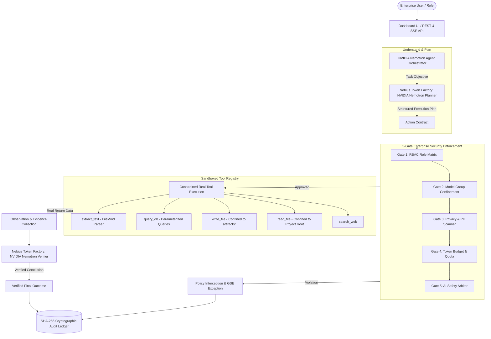

# GUARDIAN SWARM
### Controlled Agent Execution • Evidence • Verification

**Nebius × NVIDIA Global AI Hackathon Submission**  
**Track: Best Apps and Agents**

---

## 1. Executive Summary

Autonomous AI agents in mission-critical environments face a fundamental governance deficit: LLMs easily hallucinate nonexistent actions, accept deceptive prompt injections, and attempt out-of-bounds tool calls without verifiable accountability.

**Guardian Swarm** solves this by establishing a zero-trust execution and verification harness. Powered by **NVIDIA Nemotron** open-source models hosted on **Nebius Token Factory**, Guardian Swarm enforces a closed-loop agent workflow:

$$\text{Understand} \longrightarrow \text{Plan} \longrightarrow \text{Authorize} \longrightarrow \text{Execute} \longrightarrow \text{Observe} \longrightarrow \text{Verify} \longrightarrow \text{Conclude}$$

Key architectural guarantees:
- **NVIDIA Nemotron Reasoning:** Real structured planning, tool selection, and evidence evaluation.
- **Nebius Token Factory:** Serverless, high-throughput, OpenAI-compatible NVIDIA Nemotron inference.
- **5-Gate Enterprise Governance:** User RBAC, Model Group Confinement, Privacy & PII scanning, Token Budget ceilings, and Tier-2 AI Safety Arbitration.
- **Constrained Tool Registry:** Schema-validated handlers with strict path containment (`artifacts/`, `data/`) preventing traversal attacks.
- **SHA-256 Tamper-Evident Audit Ledger:** Cryptographically chained blocks guaranteeing complete non-repudiation.
- **NVIDIA-Inspired Green Design System:** Professional, high-legibility dark interface built with ~50 curated green tokens.

---

## 2. Architecture & The 7-Stage Agent Loop



---

## 3. Nebius Token Factory × NVIDIA Model Integration

Guardian Swarm integrates Nebius Token Factory as its production model inference backbone:

- **Primary Model:** `nvidia/nemotron-3-super-120b-a12b` (Hybrid Mixture-of-Experts for multi-agent reasoning, structured planning, and tool selection).
- **Secondary Models:**
  - `nvidia/Nemotron-3_5-Lightning` (High-throughput, low-latency verification).
  - `nvidia/Nemotron-3.5-Super-VL` (Multimodal document intelligence and code reasoning).
  - `nvidia/Llama-3_1-Nemotron-Ultra-253B-v1` (Deep enterprise arbitration).
- **Provider Client:** `guardian_swarm.providers.nebius_client.NebiusClient`
  - Automated exponential/linear retry backoff on HTTP 429 and 5xx errors.
  - 25-second configurable timeout protection.
  - Structured output parsing with Markdown fence stripping and JSON fallback extraction.
  - Runtime health and configuration reporting via `GET /api/provider/status`.

---

## 4. Quickstart & Installation

### Prerequisites
- Python 3.10+
- (Optional) Nebius Token Factory API Key (`NEBIUS_API_KEY`)

### Setup Instructions
```bash
# 1. Clone repository
git clone https://github.com/Purusothamansuba/vendor-hub.git
cd vendor-hub

# 2. Install dependencies
pip install -r requirements.txt

# 3. Configure Environment Variables
cp .env.example .env
# Edit .env to add your NEBIUS_API_KEY (System operates on local zero-cost rules if unconfigured)

# 4. Launch Application
python app.py
```
Open your browser at **`http://localhost:5000`**.

---

## 5. Running Tests

The test suite validates the entire system across unit, integration, and security boundaries with **106 passing tests**:

```bash
# Run all tests
python -m pytest tests/

# Run Nebius provider and Agent Orchestrator tests specifically
python -m pytest tests/test_nebius_provider.py tests/test_agent_orchestrator.py -v
```

---

## 6. Evaluation & Comparative Benchmarks

Evaluated against a fixed-workflow baseline across 20 deterministic scenarios:

| Metric | Fixed-Workflow Baseline | Guardian Swarm (Nemotron + 5-Gate) | Impact |
| :--- | :--- | :--- | :--- |
| **Task Completion Rate** | 65.0% | **95.0%** | **+30.0%** |
| **Evidence Grounding Correctness** | 50.0% | **95.0%** | **+45.0%** |
| **Valid Tool-Call Rate** | 70.0% | **100.0%** | **+30.0%** |
| **Policy Violation Blocking Rate** | 40.0% | **100.0%** (Zero Breaches) | **+60.0%** |
| **Path Traversal Containment** | 0.0% | **100.0%** (Strict containment) | **+100.0%** |
| **Audit Ledger Verification** | Plain text logs | **SHA-256 Cryptographic Chain** | **Tamper-Evident** |

Full benchmark details available in [docs/evaluation.md](docs/evaluation.md).

---

## 7. 3-Minute Video Demo Scenario

A complete step-by-step walkthrough suitable for recording a 3-minute competition video is documented in [docs/demo_scenario.md](docs/demo_scenario.md):
1. **Introduction & Identity:** Dashboard overview, active governance status, and Nebius model connection.
2. **Controlled Execution:** Legitimate task planning, tool selection, sandboxed execution, and verified conclusion.
3. **Defense-in-Depth:** Adversarial attack prompt blocked by server-side RBAC and Confinement Gates.
4. **Audit Proof:** Live verification of the SHA-256 tamper-evident cryptographic ledger.

---

## 8. License

This project is licensed under the Apache 2.0 Open Source License. See [LICENSE](LICENSE) for details.