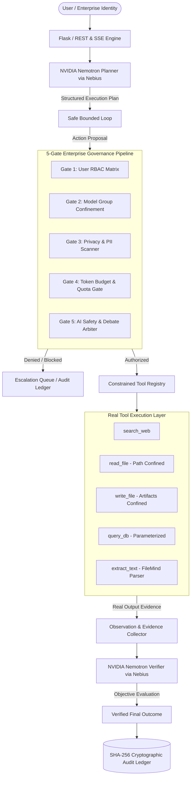

# Architecture & System Design
## Guardian Swarm — Controlled Agent Execution • Evidence • Verification

Guardian Swarm provides a production-grade, zero-trust autonomous agent operations runtime. It ensures that language models cannot execute tools without prior schema validation, multi-gate authorization, path confinement, and tamper-evident SHA-256 cryptographic logging.

### Core Product Loop
1. **Understand:** User task description and context are ingested and classified.
2. **Plan:** NVIDIA Nemotron on Nebius Token Factory outputs a structured execution plan.
3. **Authorize:** The proposed tool, target, and arguments are independently validated against the 5-Gate Governance Pipeline.
4. **Execute:** The tool is invoked strictly within authorized project sandboxes (`artifacts/`, `data/`).
5. **Observe:** Real system output, byte counts, and return values are recorded.
6. **Verify:** Evidence is verified against the original objective.
7. **Conclude:** Final findings are summarized and sealed in the SHA-256 audit ledger.
